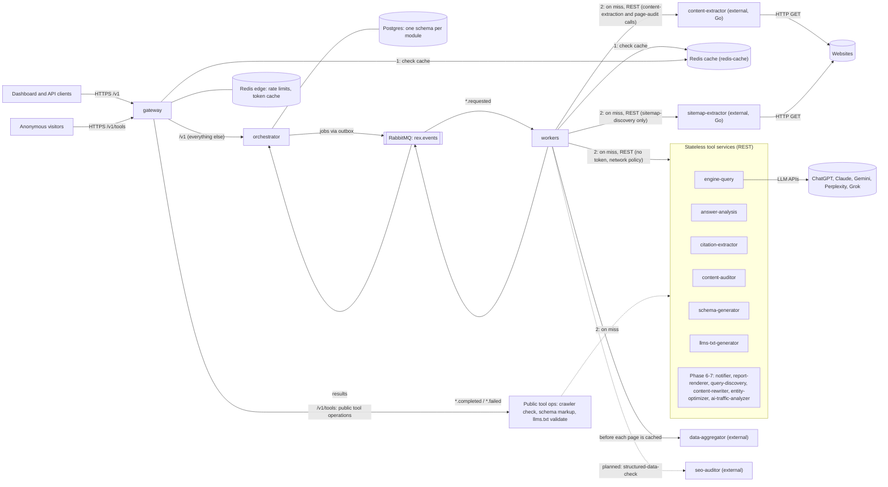
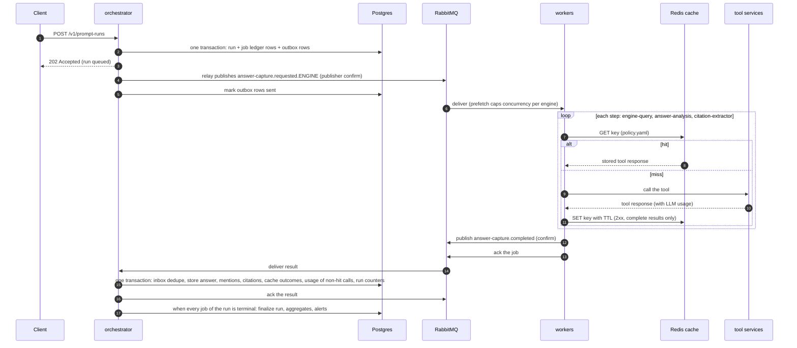
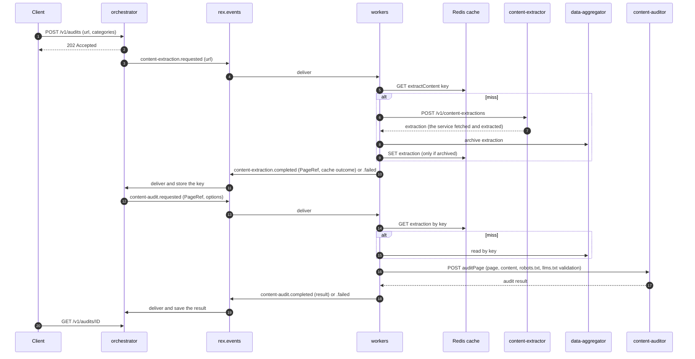
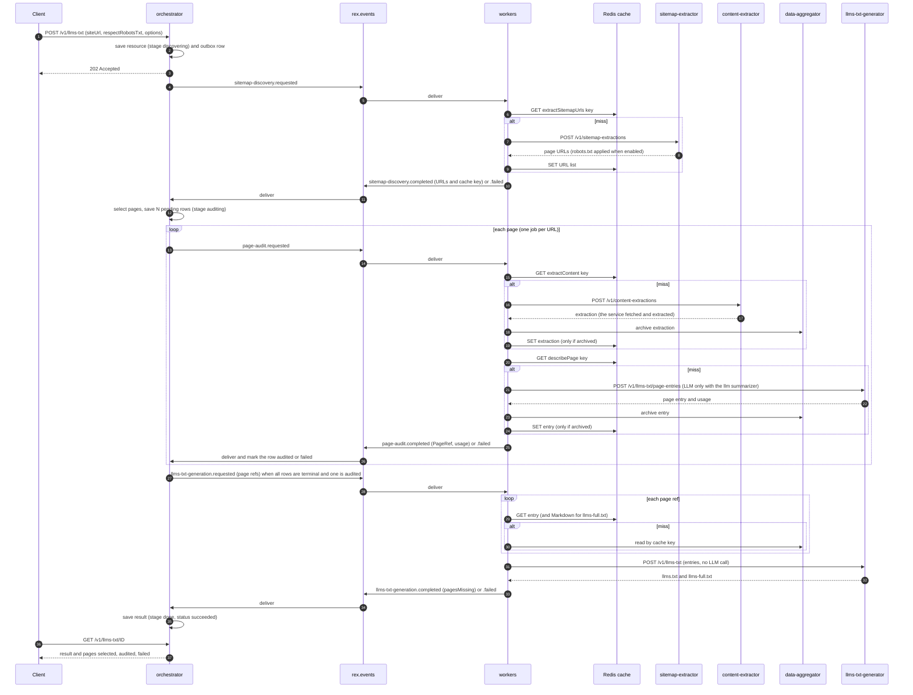
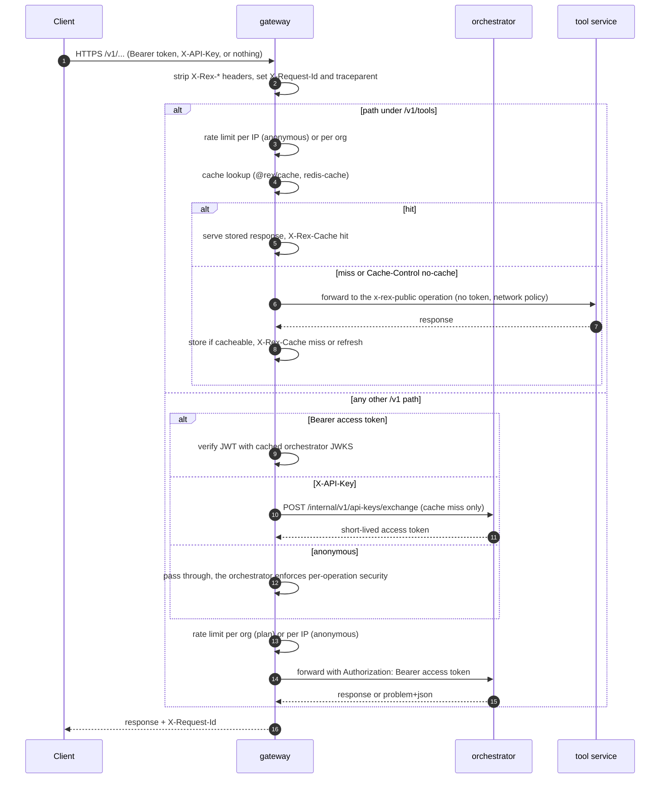
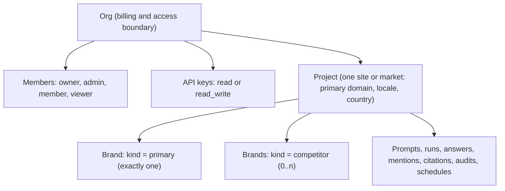

# Architecture

REx is a monorepo of independently deployable services in three kinds: **stateless
tool services**, one **stateful orchestrator**, and **stateless workers** that connect
them through a **RabbitMQ bus**, with a thin **edge gateway** in front. Every tool call
is **cache first**: workers and the gateway check a shared cache before calling a tool.
Websites are read only by **external** services, chiefly the content-extractor and
the sitemap-extractor (implemented in Go outside this repo, to contracts defined here); only workers call
external services, and no tool touches the network except LLM APIs
([ADR 0021](adr/0021-content-extraction.md)). Extracted pages are archived to the
external data-aggregator before they are cached ([ADR 0022](adr/0022-page-archive.md)).
This page is the authority for the repo layout, the service map, data ownership,
communication, the job lifecycle, caching, scheduling, the gateway flow and tenancy. Rules live in
[conventions.md](conventions.md); decisions and reasons live in [adr/](adr/README.md).

## Repository layout

```
v3/                                # REx v3 repo root (~/projects/REx/v3)
├── apps/
│   ├── dashboard/                 # Next.js web UI; calls only the gateway (client generated from its vendored orchestrator spec)
│   └── docs/                      # public API docs built from the bundled specs
├── services/
│   ├── _template/                 # TypeScript tool template: scripts/new-tool generates tools from it (Phase 1)
│   ├── _template-python/          # Python tool template, added when the first Python tool is scheduled (ADR 0024)
│   ├── _template-go/              # Go tool template, added when the first Go tool is scheduled (ADR 0024)
│   ├── <tool>/                    # 12 tool services (kind: tool): each a SELF-CONTAINED project in its language (ts, python or go), not in the pnpm workspace
│   │   ├── AGENTS.md              #   generated instructions for coding agents working on this tool
│   │   └── contract/              #   vendored, generated copies of its contract (ADR 0018)
│   ├── gateway/                   # edge: auth, rate limits, routing (kind: gateway)
│   ├── orchestrator/              # the only stateful service (kind: orchestrator)
│   └── workers/                   # stateless job runners (kind: workers)
├── packages/                      # only what ADR 0019 allows
│   ├── contracts/                 # SOURCE OF TRUTH for every contract (data, no code; vendored, never imported)
│   │   ├── openapi/common.yaml    #   shared OpenAPI components
│   │   ├── openapi/services/      #   one OpenAPI file per service (<service>.yaml)
│   │   ├── asyncapi/events.yaml   #   every bus message
│   │   ├── bus/topology.yaml      #   RabbitMQ exchanges, queues, bindings, retry, DLX
│   │   ├── cache/policy.yaml      #   cache keys, scopes, TTLs and their overrides
│   │   ├── data/ai-crawlers.yaml  #   known AI crawler list
│   │   ├── handoff/               #   GENERATED self-contained contracts for externally built services (content-extractor, sitemap-extractor)
│   │   └── vendoring.yaml         #   which contract files are vendored into which service
│   ├── cache/                     # @rex/cache, published + pinned: cache-first tool calls (workers + gateway only)
│   └── bus/                       # @rex/bus, published + pinned: topology, confirms, consume, retry (orchestrator + workers only)
├── infra/
│   ├── docker/                    # base images
│   ├── k8s/                       # Helm library chart + one release per service, NetworkPolicies
│   └── terraform/                 # Postgres, buckets, DNS, secrets (RabbitMQ and Redis are self-hosted in k8s)
├── scripts/                       # repo scripts; which ones, and the phase that builds each: roadmap (Phase 0 interim script, Phase 1 items, Phase 3 routes)
│   └── tools/                     #   dev-only generator pins per tool language (python/, go/), added with that language's bring-up
├── docs/                          # engineering docs (this folder); docs/agents/ holds the per-tool AGENTS.md template
├── AGENTS.md                      # entry point for coding agents (CLAUDE.md, .cursor/rules/rex.mdc and
│                                  #   .github/copilot-instructions.md only point to it)
├── .github/workflows/             # CI: contracts, per-tool portability, platform lint/test/build, deploy changed only
├── redocly.yaml                   # OpenAPI lint/bundle config (the only OpenAPI linter)
├── docker-compose.yml             # local Postgres, RabbitMQ (1 node), Redis (cache + edge), Mailpit, all services
├── turbo.json                     # platform tasks only
├── pnpm-workspace.yaml            # apps/*, packages/cache, packages/bus, gateway, orchestrator, workers (NOT tools)
├── package.json                   # pinned dev tools only (the list: roadmap Phase 1.1)
└── README.md
```

Phase 0 established the docs, contracts and tool folders. See the [roadmap](roadmap.md)
for the Phase 1 tooling that generates each tool's `AGENTS.md` and vendored `contract/`.

### Per-service layouts

**Tool service**: a self-contained project in its language
([ADR 0018](adr/0018-tool-portability.md), [ADR 0024](adr/0024-per-tool-language.md));
copy the folder anywhere and its install, build, test and `docker build .` work. No
`migrations/`, no `repo/`, no bus, cache or auth code, no import from outside the folder.
Every language has the same parts: `contract/` (generated), the app bound to the
contract, config, problem+json errors, telemetry, the LLM adapter (LLM tools only),
handlers per operationId, a pure domain, tests with `fixtures/llm/`, a manifest with its
lockfile, a Dockerfile, the generated `AGENTS.md`, `.template.json`, `.env.example` and
a README.

TypeScript (`ts`, the default; template `services/_template`):

```
services/<tool>/
├── contract/            # GENERATED, committed, never edited (scripts/vendor-contracts)
│   ├── openapi.yaml     #   the tool's spec bundled into one self-contained file
│   ├── types.ts         #   openapi-typescript types
│   └── ...              #   data it needs, e.g. ai-crawlers.yaml (content-auditor)
├── src/
│   ├── app.ts           # Fastify app: routes bound to operationIds from contract/openapi.yaml (template)
│   ├── server.ts        # entry point: config, telemetry, listen (template)
│   ├── config.ts        # env-schema (template base + tool vars)
│   ├── errors.ts        # problem+json mapping (template)
│   ├── llm/             # LLM adapter over the official SDKs, LLM_MODE live|mock|record (template; LLM tools only)
│   ├── handlers/        # one per operationId: read input, call domain, shape output
│   └── domain/          # the tool's logic (pure where possible)
├── test/                # vitest: unit, contract (responses validated against contract/), fixtures/llm/
├── package.json         # public npm dependencies only, exact versions
├── package-lock.json
├── tsconfig.json, eslint.config.js, .prettierrc   # template copies
├── Dockerfile           # multi-stage, non-root, healthcheck (template)
├── AGENTS.md            # GENERATED instructions for coding agents (template; repo paths as text, no links out)
├── .template.json       # template version + hash of every template-generated file
├── .env.example         # generated from config.ts
└── README.md            # how to run alone; link to docs/services/<tool>.md
```

Python (`python`; template `services/_template-python`, added with the first Python
tool; details confirmed by the Python spike):

```
services/<tool>/
├── contract/            # GENERATED: openapi.yaml, models.py (datamodel-code-generator, pydantic v2), data files
├── src/<tool_pkg>/
│   ├── app.py           # FastAPI app; openapi-core validates requests against contract/openapi.yaml (template)
│   ├── main.py          # entry point: config, telemetry, uvicorn (template)
│   ├── config.py        # pydantic-settings (template base + tool vars)
│   ├── errors.py        # problem+json exception handlers (template)
│   ├── llm/             # LLM adapter over the official SDKs, LLM_MODE live|mock|record (template; LLM tools only)
│   ├── handlers/        # one per operationId
│   └── domain/          # the tool's logic (pure where possible)
├── tests/               # pytest: unit, contract (responses validated with openapi-core), fixtures/llm/
├── pyproject.toml       # public PyPI dependencies only, == pins; ruff, mypy and import-linter settings
├── uv.lock
├── .python-version
├── Dockerfile, AGENTS.md, .template.json, .env.example, README.md   # as above
```

Go (`go`; template `services/_template-go`, added with the first Go tool; details
confirmed by the Go spike):

```
services/<tool>/
├── contract/            # GENERATED: openapi.yaml, types.gen.go (oapi-codegen types + embedded spec, package contract), data files
├── cmd/server/main.go   # entry point: config, telemetry, listen; `healthcheck` subcommand for the container (template)
├── internal/
│   ├── app/             # net/http router; kin-openapi validates requests against the embedded spec (template)
│   ├── config/          # caarlos0/env (template base + tool vars)
│   ├── problem/         # problem+json responses (template)
│   ├── llm/             # LLM adapter over the official SDKs, LLM_MODE live|mock|record (template; LLM tools only)
│   ├── handlers/        # one per operationId
│   └── domain/          # the tool's logic (pure where possible)
├── test/fixtures/llm/   # go test files sit next to the code; contract tests validate responses with kin-openapi
├── go.mod               # public modules only, no replace directives
├── go.sum
├── .golangci.yml        # golangci-lint with depguard (template)
├── Dockerfile, AGENTS.md, .template.json, .env.example, README.md   # as above (distroless, non-root)
```

**Orchestrator** (modular monolith; each module owns one Postgres schema):

```
services/orchestrator/
├── src/
│   ├── modules/<module>/          # identity, catalog, tracking, optimization,
│   │   ├── index.ts               #   scheduling, billing, alerts, messaging
│   │   ├── routes/ handlers/      #   (index.ts is the module's only public interface)
│   │   ├── domain/
│   │   └── repo/                  #   reads/writes only this module's schema
│   ├── server.ts                  # HTTP API
│   └── background.ts              # outbox relay, results consumer, scheduler tick, job reconciler
├── migrations/<module>/           # one migration folder per module schema
├── test/
├── contract/                      # vendored: own spec, events, topology, cache policy
├── Dockerfile
├── package.json
└── README.md
```

**Workers** (one codebase, one flow per job type, no HTTP API besides probes):

```
services/workers/
├── src/
│   ├── flows/<job>.ts   # e.g. answer-capture.ts: chain tool calls via generated clients,
│   │                    #   each wrapped by @rex/cache (cache first)
│   └── main.ts          # subscribes to the queues named in WORKER_QUEUES
├── contract/            # vendored: events, topology, cache policy, specs of the tools it calls
├── test/
├── Dockerfile
├── package.json
└── README.md
```

## Service map



| Kind | Services | State | Database | Bus | May call |
|---|---|---|---|---|---|
| gateway | gateway | none of its own (rate limits and token cache in `redis-edge`; tool results in the shared cache) | no | no | orchestrator, `x-rex-public` tool operations (cache first) |
| orchestrator | orchestrator | **all** platform state | **sole owner and writer** | publishes jobs, consumes results | external SaaS only (Stripe); never tools |
| workers | workers | none of its own (tool results in the shared cache) | no | consume jobs, publish results | tool services and the external services: the content-extractor and sitemap-extractor (cache first), the data-aggregator, the seo-auditor; never the orchestrator over HTTP |
| tool | engine-query, answer-analysis, citation-extractor, content-auditor, schema-generator, llms-txt-generator, notifier, report-renderer, query-discovery, content-rewriter, entity-optimizer, ai-traffic-analyzer | none | no | no | LLM provider APIs only (Phase 6 notifier: its delivery APIs); never websites, another REx service or the content-extractor. No auth inside: reachable only from workers and the gateway ([ADR 0014](adr/0014-auth.md)) |
| external | content-extractor, sitemap-extractor, seo-auditor, data-aggregator | owned outside this repo (the content-extractor is stateless per its contract; the data-aggregator keeps the page archive) | no | no | websites at most; called only by workers ([ADR 0021](adr/0021-content-extraction.md), [ADR 0022](adr/0022-page-archive.md)) |

| Service | Kind | Phase | Doc | Contract |
|---|---|---|---|---|
| gateway | gateway | 3 | [gateway](services/gateway.md) | [openapi](../packages/contracts/openapi/services/gateway.yaml) |
| orchestrator | orchestrator | 3 | [orchestrator](services/orchestrator.md) | [openapi](../packages/contracts/openapi/services/orchestrator.yaml) |
| workers | workers | 4 | [workers](services/workers.md) | [events](../packages/contracts/asyncapi/events.yaml) |
| engine-query | tool | 2 | [engine-query](services/engine-query.md) | [openapi](../packages/contracts/openapi/services/engine-query.yaml) |
| answer-analysis | tool | 2 | [answer-analysis](services/answer-analysis.md) | [openapi](../packages/contracts/openapi/services/answer-analysis.yaml) |
| citation-extractor | tool | 2 | [citation-extractor](services/citation-extractor.md) | [openapi](../packages/contracts/openapi/services/citation-extractor.yaml) |
| content-auditor | tool | 2 | [content-auditor](services/content-auditor.md) | [openapi](../packages/contracts/openapi/services/content-auditor.yaml) |
| schema-generator | tool | 2 | [schema-generator](services/schema-generator.md) | [openapi](../packages/contracts/openapi/services/schema-generator.yaml) |
| llms-txt-generator | tool | 2 | [llms-txt-generator](services/llms-txt-generator.md) | [openapi](../packages/contracts/openapi/services/llms-txt-generator.yaml) |
| notifier | tool | 6 | [notifier](services/notifier.md) | Phase 6 |
| report-renderer | tool | 6 | [report-renderer](services/report-renderer.md) | Phase 6 |
| query-discovery | tool | 7 | [query-discovery](services/query-discovery.md) | Phase 7 |
| content-rewriter | tool | 7 | [content-rewriter](services/content-rewriter.md) | Phase 7 |
| entity-optimizer | tool | 7 | [entity-optimizer](services/entity-optimizer.md) | Phase 7 |
| ai-traffic-analyzer | tool | 7 | [ai-traffic-analyzer](services/ai-traffic-analyzer.md) | Phase 7 |
| content-extractor | external | 5 | [content-extractor](services/content-extractor.md) | [openapi](../packages/contracts/openapi/services/content-extractor.yaml) (implemented outside this repo) |
| sitemap-extractor | external | 5 | [sitemap-extractor](services/sitemap-extractor.md) | [openapi](../packages/contracts/openapi/services/sitemap-extractor.yaml) (implemented outside this repo; a separate service or an endpoint of the content-extractor, the implementer's choice) |
| seo-auditor | external | 5 | [seo-auditor](services/seo-auditor.md) | not known yet (deferred) |
| data-aggregator | external | 5 | [data-aggregator](services/data-aggregator.md) | not known yet (deferred) |

## Data ownership

The orchestrator is the only service with a database and the only writer of it (and of
object storage). Inside it, each module owns one Postgres schema and runs its own
migrations; a module never reads or writes another module's tables and talks to other
modules only through their `index.ts` interface (enforced by dependency-cruiser). A
request may still use one database transaction across modules through that interface
(for example "create prompt run + jobs + outbox rows" atomically).

| Module (schema) | Phase | Owns (authoritative list of entities) |
|---|---|---|
| `identity` | 3 | users, credentials, refresh tokens, orgs, memberships, API keys (hashed), service clients, signing keys |
| `catalog` | 3 | projects, brands (primary and competitors) |
| `tracking` | 4 | prompts, prompt runs, answers, mentions, citations, per-run and daily visibility and domain aggregates |
| `optimization` | 5 | audits, llms.txt generations and their selected pages (status and metadata); later rewrites, entity audits, AI traffic rollups (Phase 7) |
| `scheduling` | 4 | schedules, firing log |
| `billing` | 6 | plans, subscriptions, entitlements, usage ledger (from tool `usage` in results), Stripe mapping |
| `alerts` | 6 | alert rules, notification channels, delivery log |
| `messaging` | 3 (bus tables 4) | outbox, inbox (processed message IDs), job ledger (idempotency key -> subject, status, attempts), HTTP idempotency keys |

Tools receive everything they need in the request and return everything they produce
in the response. They never see org or project IDs; brands are passed as opaque keys.

## Communication

| Path | Style | How |
|---|---|---|
| Dashboard / API client -> orchestrator | sync REST | via gateway; the dashboard uses a client generated from its vendored orchestrator spec |
| Anonymous visitor -> public tool operation | sync REST, cache first | via gateway `/v1/tools/...` to operations marked `x-rex-public` |
| Orchestrator -> workers | async job | `<job>.requested` through the transactional outbox and RabbitMQ |
| Worker -> tool | sync REST, cache first | `@rex/cache` checks the cache; on a miss the generated client calls the tool (no token, per-operation timeout) |
| Worker -> content-extractor | sync REST, cache first | `content-extraction` and `page-audit` flows (the service fetches and extracts; the worker only calls it), at `CONTENT_EXTRACTOR_URL`, client generated from its vendored spec (no token, private network, `maxDuration` timeout) |
| Worker -> sitemap-extractor | sync REST, cache first | `sitemap-discovery` flow, at `SITEMAP_EXTRACTOR_URL`, client generated from its vendored spec (no token, private network, `maxDuration` timeout) |
| Worker -> data-aggregator | sync; write before the cache write, read after a cache miss | writes every fresh result with `archiveTo` (extractions, page entries), reads page results back after a cache miss when a job gets them [by reference](#page-results-by-reference) (`content-audit`, `llms-txt-generation`), at `DATA_AGGREGATOR_URL` ([ADR 0022](adr/0022-page-archive.md), [ADR 0023](adr/0023-llms-txt-pipeline.md)); interface not known yet |
| Worker -> seo-auditor | sync, planned | `structured-data-check` flow, at `SEO_AUDITOR_URL`; interface not known yet |
| Workers -> orchestrator | async result | `<job>.completed` / `<job>.failed` on RabbitMQ (never REST, never the DB) |
| Gateway -> orchestrator identity | sync REST | service-token issuing and API-key exchange (`/internal/v1/...`), JWKS; the only internal calls |

Rules:
- Tools never call another REx service, never touch the bus, never persist anything and
  never authenticate callers: a default-deny NetworkPolicy admits only workers and the
  gateway ([ADR 0014](adr/0014-auth.md)).
  Multi-tool flows are chained by a worker (see `content-audit`: llms-txt-generator
  validation feeds content-auditor).
- Tools never fetch anything: the orchestrator publishes `content-extraction` jobs, a
  worker calls the content-extractor (the service fetches and extracts), and the
  orchestrator passes the page on to the tool jobs
  [by reference](#page-results-by-reference) (multi-page flows such as llms.txt: see
  the [orchestrator](services/orchestrator.md#notes)). Only workers call external services
  (content-extractor, sitemap-extractor, data-aggregator, seo-auditor); the orchestrator, the gateway and
  tools never do ([ADR 0021](adr/0021-content-extraction.md)).
- Workers keep no state between messages; everything a job needs is in its message or
  referenced by it ([page results by reference](#page-results-by-reference)).
- No tool is called without a cache check first (see [Caching](#caching)).
- The orchestrator never calls tools directly: all slow or retryable work goes through
  jobs, so there is one path for retries, concurrency caps and cost accounting.
- Delivery is at-least-once; details in [events.md#delivery](events.md#delivery).

## Job lifecycle



- **Job granularity** is one unit of LLM work (one prompt x engine x sample), so prefetch
  limits concurrent LLM calls and one failure retries only that unit.
- **Job ledger**: every job has an idempotency key and a status (`pending`, `published`,
  `succeeded`, `failed`). A result whose key is already terminal is acknowledged and ignored.
- **Reconciler** (replaces replay): jobs still `published` after their type's deadline
  are republished with the same key a limited number of times, then marked failed.
  Deadlines and republish count are configuration (defaults: answer capture 2 h, content
  extraction 30 min, audit 30 min, sitemap discovery 30 min, page audit 30 min,
  llms.txt generation 15 min plus 1 s per page, 2 republishes; placeholders until the retry policy is decided,
  see [roadmap](roadmap.md#deferred-decisions)). A republished job is cheap: its finished
  steps hit the cache. The database, not the broker, is the source of truth.

### Page results by reference

The one pattern of both page flows, audits and the llms.txt pipeline
([ADR 0023](adr/0023-llms-txt-pipeline.md)); messages never carry page bodies.

1. **Produce.** A worker calls the service cache first: the content-extractor fetches
   and extracts the page (and llms-txt-generator `describePage` writes its entry in
   the pipeline); the worker only makes the calls. A fresh result is archived to the
   data-aggregator, then cached ([store rules](../packages/contracts/cache/policy.yaml)).
   These calls are listed under `byReference` in policy.yaml and are stored even in
   `bypass` mode (it acts as `refresh` there).
2. **Report.** The `.completed` message carries a page reference (`PageRef`: the URL
   and the cache keys, which are also the data-aggregator keys) and the cache
   outcomes, never the result.
3. **Pass on.** The orchestrator stores only the keys and puts the reference into the
   next job (`AuditJob.page`, `LlmsTxtGenerationJob.pages`).
4. **Read.** The reading worker gets each result by key from the **cache first, then
   the data-aggregator** (decided by Jay). Reads ignore the job's cache mode: they
   reuse what the producing job stored. A result found in neither fails a
   `content-audit` (step `readPageResult`, code `page_result_missing`, final: a retry
   cannot find it) and leaves the page out of an `llms-txt-generation`
   (`pagesMissing`).

| Flow | Produces (reports a `PageRef`) | Reads by reference |
|---|---|---|
| Audit (`createAudit`) | `content-extraction`: `extractContent` | `content-audit`: the extraction, then `validateLlmsTxt` and `auditPage` |
| llms.txt pipeline | `page-audit`: `extractContent`, `describePage` | `llms-txt-generation`: the entries (and Markdown for llms-full.txt), then `generateLlmsTxt` |



### llms.txt pipeline

The llms.txt crawl is event-driven ([ADR 0023](adr/0023-llms-txt-pipeline.md)): the
orchestrator owns the state and publishes through its outbox, workers call stateless
services over REST, services never touch the bus, and pages travel
[by reference](#page-results-by-reference), never as bodies. Retries and dead-lettering are the bus's (above); the
reconciler times out stuck page audits and the generation.



## Caching

Every tool call goes through `@rex/cache` in the caller (workers, gateway); tools
never see the cache ([ADR 0016](adr/0016-cache-first.md)). The key derivation, modes,
store rules and TTL or window per operation are defined once in
[cache/policy.yaml](../packages/contracts/cache/policy.yaml); this page does not
restate them.

- **Where:** workers (every step of every flow, including content-extractor calls) and
  the gateway (public tool operations). The orchestrator never calls tools or the
  content-extractor, so it needs no cache.
- **Backend:** self-hosted Redis, instance `redis-cache` (LRU eviction, no persistence),
  shared by all worker and gateway replicas; separate from `redis-edge`, which holds the
  gateway's rate limits and token cache.
- **Control:** jobs carry `cache` (`CacheDirective`: mode, variant and the org's
  per-customer overrides); orchestrator endpoints accept `cacheMode`; public calls honor
  `Cache-Control: no-cache`.
- **Scope and TTLs:** entries are shared across customers by default; an operation or a
  customer can be switched to tenant-scoped entries, and TTLs can be changed per
  environment and per customer, all as configuration (policy.yaml `scopes` and
  `resolution`).
- **Reporting:** every result carries one `ToolCallCache` per call; the gateway sets
  `X-Rex-Cache` and `X-Rex-Cached-At`.
- **Redelivery:** a redelivered or retried job finds its finished steps in the cache, so
  only the failed step calls a tool again; single-flight locks stop a job and its
  redelivery from both calling the same LLM.
- **Failure mode:** if Redis is unavailable, callers go straight to the tool (higher
  cost, same results).

## Scheduling with 2+ orchestrator replicas

Schedule state lives in `scheduling.schedules`; every replica runs a tick every 15 s:

1. In one transaction, `SELECT ... WHERE enabled AND next_run_at <= now() ORDER BY
   next_run_at LIMIT 100 FOR UPDATE SKIP LOCKED`.
2. For each row: insert the firing (`UNIQUE (schedule_id, scheduled_for)`), start the
   target through the owning module (which writes its jobs and outbox rows in the same
   transaction), and set `next_run_at` to the next cron time after now.
3. Commit.

`SKIP LOCKED` lets replicas share the work without leader election, and the unique
firing key makes a double fire impossible. After downtime a schedule fires once, not
once per missed slot. The outbox relay and the job reconciler claim rows the same way,
so all background loops are safe on any number of replicas.

## Gateway flow



Why the gateway stays separate: [ADR 0013](adr/0013-edge-gateway.md).

## Tenancy model: org > project > brand



- **Org** is the tenant: billing, plan limits, members and API keys attach here. Every
  token carries exactly one org; users in several orgs switch with `POST /v1/auth/refresh {orgId}`.
- **Project** groups everything tracked for one site or market.
- **Brand** is a name to detect in answers, with aliases and owned domains; exactly one
  `primary` per project, any number of `competitor`s.
- Roles are org-wide in v1. Anonymous free-tool results have `orgId = null`.
- Isolation lives only in the orchestrator: org filters from the verified token plus
  Postgres row-level security ([conventions.md](conventions.md#10-tenancy-in-code)).
  Messages carry `orgId`/`projectId` in the envelope for tracing; tools never see them.

## LLM concurrency and cost

- Each engine has its own queue (`rex.workers.answer-capture.<engine>`). Maximum
  concurrent calls to an engine = queue prefetch x worker replicas consuming it.
- A provider rate limit or outage makes the tool answer 503 with `Retry-After`; the
  worker moves the job to the next retry delay of its queue ([events.md#delivery](events.md#delivery)).
- Tools report every LLM call in their response `usage`; workers pass it through in the
  result; the orchestrator's billing module meters it, except for calls whose cache
  outcome is `hit` (already paid when the value was produced).
- The cache absorbs repeats: the same prompt on the same engine, locale and sample is
  answered once per day across all projects (window in policy.yaml).
- Deterministic methods come first ([ADR 0017](adr/0017-deterministic-first-analysis.md)):
  mention detection is always deterministic and sentiment defaults to a deterministic
  analyzer; LLM analyzers are opt-in and comparable. Before publishing jobs the
  orchestrator checks the org's entitlements (prompts, engines, runs per day).

## Runtime and deployment

- One Docker image per service. Orchestrator: 2+ replicas, each running the API and the
  background loops (they can be split by `ORCHESTRATOR_ROLES` later). Workers: one
  deployment per queue group via `WORKER_QUEUES`, autoscaled on queue depth (KEDA
  RabbitMQ scaler). Tools: autoscaled on CPU and request rate.
- RabbitMQ 4.x **self-hosted**: a 3-node quorum cluster in production, a single node in
  development ([ADR 0011](adr/0011-rabbitmq-bus.md)). Redis **self-hosted**: `redis-cache`
  (gateway + workers) and `redis-edge` (gateway only) ([ADR 0016](adr/0016-cache-first.md)).
  Managed Postgres and object storage, owned by the orchestrator.
- Local: `docker compose up` runs Postgres, RabbitMQ, both Redis instances, Mailpit and all services;
  each tool also runs alone from its folder (its language's dev command, or `docker run`) and needs
  nothing else, not even the rest of the repo.
